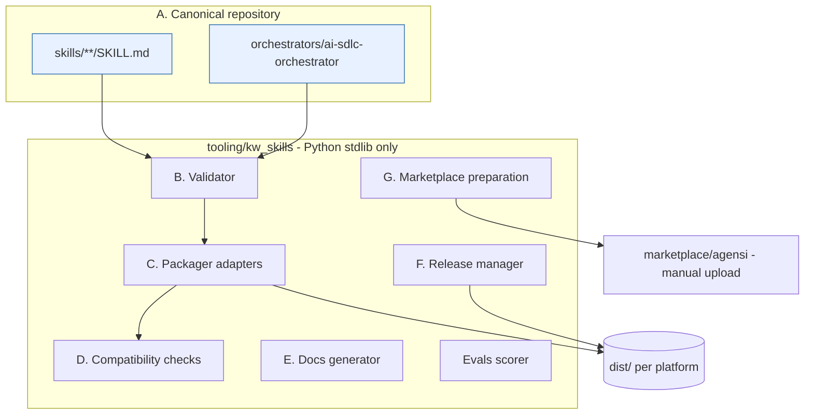
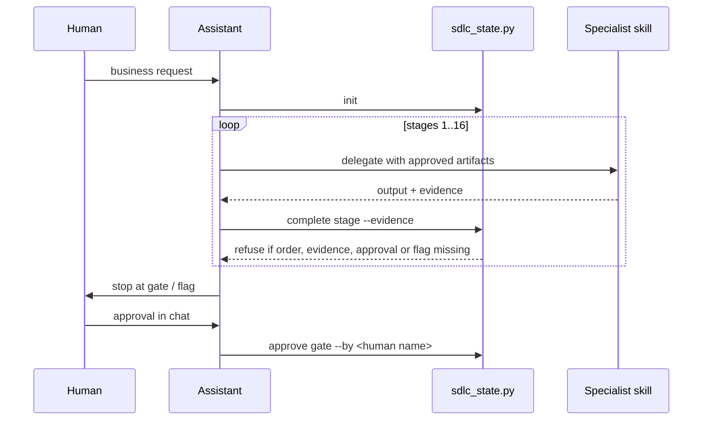
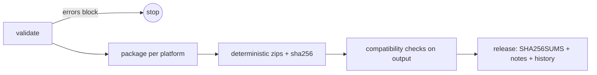
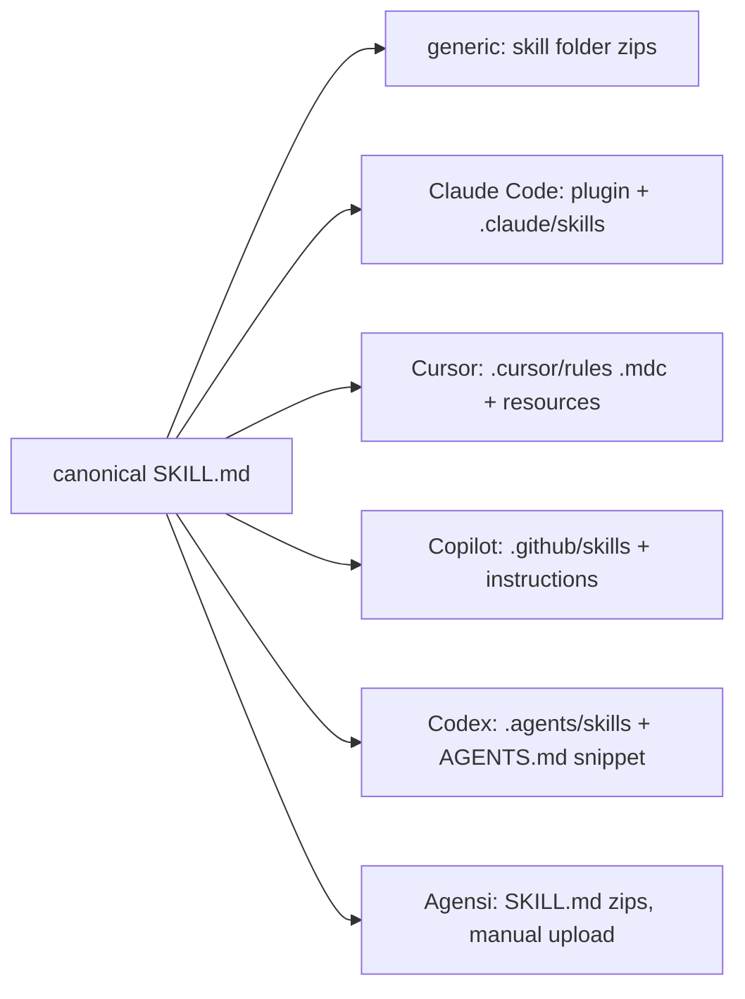
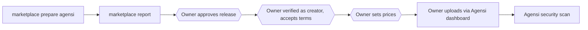

# Architecture

One canonical source, many generated outputs. Everything generated is reproducible and disposable; only `skills/` and `orchestrators/` are authoritative.

## Product architecture

Layer to module map: A `skills/`, `orchestrators/` · B `validator.py` · C `packager.py` · D `compatibility.py` · E `docsgen.py` · F `release.py` · G `marketplace.py` · evaluation `evals.py` · CLI `cli.py`.
The brief proposed `tooling/validator|packager|...` directories; one flat package was chosen instead because the layers share the parser and finding types, and a single zero-dependency package is simpler to install and test.

## Skill execution lifecycle

Progressive disclosure: only `name` and `description` are loaded at startup; `SKILL.md` on activation; `references/`, `templates/`, `scripts/` only when needed.

## Packaging workflow

## Platform compatibility

Adapters never edit the canonical skill; they copy, wrap or rewrite paths. Evidence level per platform is in [docs/COMPATIBILITY.md](docs/COMPATIBILITY.md).

## Marketplace release process

Diamond-shaped steps are human gates; the tool performs none of them.

## Key decisions

| Decision | Reason |
|---|---|
| Stdlib-only Python, custom frontmatter parser | No dependency supply-chain risk; frontmatter subset is strict and errors loudly |
| Gate logic in a script | Models skip steps; code does not |
| Zero network in tooling | Marketplace and platform uploads are human actions; satisfies "no hidden telemetry" |
| Deterministic zips | Reproducible checksums for release and rollback |
| No database or web UI | No requirement justifies one yet; Skill Explorer is a roadmap phase |
| Honest compatibility levels | `structural` vs `live-tested`, never merged |
