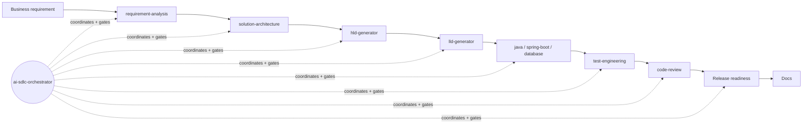

<div align="center">

# KnowledgeWala AI Engineering Skills

**Professional AI Engineering Workflows. Structured, Reusable, and Built for Real-World Software Development.**

`MIT` · `v1.0.0-rc.2 (release candidate, unpublished)` · `Python 3.10+, no runtime dependencies` · `Windows, macOS, Linux`

</div>

Use AI coding assistants as disciplined engineering partners instead of code generators: requirements before design, design before code, human approval at critical decisions, evidence for every claim.

## What you get

- **20 skills** in the open [Agent Skills](https://agentskills.io/specification) format, one canonical source:
  architecture (requirements, solution architecture, HLD, LLD), backend (Java, Spring Boot, database, API design), frontend (Angular, frontend architecture), agentic AI (agent architecture, RAG, AI testing and evaluation), quality and security (code review, test engineering, application security, performance), DevOps (AWS, CI/CD), and the flagship **`ai-sdlc-orchestrator`**. See the [catalogue](docs/SKILL_CATALOGUE.md).
- **Flagship orchestrator** with a 16-stage lifecycle whose order, evidence and human approvals are enforced by a script (`sdlc_state.py`), not just by instructions.
- **`kw-skills` CLI**: validate, package for Claude Code, Cursor, GitHub Copilot and generic agents, compatibility checks, releases with checksums, Agensi submission package preparation.
- **Evaluation rubric** to score real skill output out of 100, with rationale per criterion.
- Six realistic [sample projects](examples/README.md).



## Honest status

| Layer | Status |
|---|---|
| Structural validation (spec, policy, links, secrets, scripts) | Implemented and tested |
| Functional validation (CLI, packagers, gate script, checkers) | Implemented and tested (pytest) |
| Platform compatibility | Structural checks only. **Not live-tested** on any assistant; Cursor native skills dir unverified ([details](docs/COMPATIBILITY.md)) |
| Real-world output quality | **Not yet evaluated.** Rubric and scorer exist; no scored runs yet ([model](docs/QUALITY_MODEL.md)) |
| Marketplace | Agensi package prepared for **manual** submission; nothing published or accepted |

Skills are release-candidate quality, not certified production-ready.

## Quick start

```powershell
# Windows (PowerShell)
git clone https://github.com/dharmsahu-hash/knowledgewala-ai-engineering-skills
cd knowledgewala-ai-engineering-skills
python -m venv .venv; .\.venv\Scripts\python -m pip install -e .
.\.venv\Scripts\kw-skills list
.\.venv\Scripts\kw-skills validate
.\.venv\Scripts\kw-skills package --platform claude-code
```

```bash
# Linux / macOS
git clone https://github.com/dharmsahu-hash/knowledgewala-ai-engineering-skills
cd knowledgewala-ai-engineering-skills
python3 -m venv .venv && .venv/bin/pip install -e .
.venv/bin/kw-skills list && .venv/bin/kw-skills validate
.venv/bin/kw-skills package --platform claude-code
```

No install needed to try it: `PYTHONPATH=tooling python -m kw_skills list`.

Install skills into an assistant: [INSTALLATION.md](INSTALLATION.md). Use them: [USER_GUIDE.md](USER_GUIDE.md).

## Documentation

[ARCHITECTURE](ARCHITECTURE.md) · [INSTALLATION](INSTALLATION.md) · [USER_GUIDE](USER_GUIDE.md) · [DEVELOPER_GUIDE](DEVELOPER_GUIDE.md) · [CONTRIBUTING](CONTRIBUTING.md) · [SECURITY](SECURITY.md) · [MARKETPLACE_GUIDE](MARKETPLACE_GUIDE.md) · [ROADMAP](ROADMAP.md) · [CHANGELOG](CHANGELOG.md) · [Discovery report](docs/DISCOVERY_REPORT.md) · [Compatibility](docs/COMPATIBILITY.md) · [Quality model](docs/QUALITY_MODEL.md)

## Development gate

`powershell -File scripts/check.ps1` (or `sh scripts/check.sh`) runs tests, validation, compatibility and the catalogue check. There is no active CI workflow by design (no per-push minutes); a manual-only example is in `docs/ci-workflow.example.yml` (copy to `.github/workflows/` with a token that has the `workflow` scope).

## Licence

MIT. See [LICENSE](LICENSE) and [NOTICE](NOTICE.md). Independent product; predecessor ideas from [knowledgewala-agentic-sdlc](https://github.com/dharmsahu-hash/knowledgewala-agentic-sdlc).
