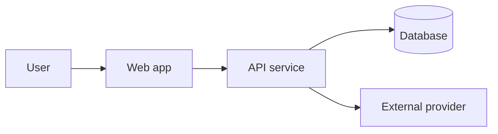

# HLD: <system>

## Overview
Goal, scope, assumptions, constraints, glossary. Requirements covered: FR-.., NFR-..

## Context Diagram

## Components
| Component | Responsibility | Owns data | Requirement ids |
|---|---|---|---|

## Data Flow
One numbered flow (and a failure path) per primary use case.

## Integration and API Boundaries
| Boundary | Style | Auth | Contract owner |
|---|---|---|---|

## Data Architecture
Stores, ownership, consistency, retention, backup.

## Infrastructure
Environments, topology, networking, scaling units.

## Security Architecture
Trust boundaries, authN/authZ, data classification, secrets, encryption, audit logging.

## Scalability and Resilience
Bottlenecks, scaling approach, failure modes, DR targets (RPO/RTO).

## Observability
Metrics, logs, traces, alerts.

## Risks and Open Questions

## Traceability
| Requirement | Design element |
|---|---|
