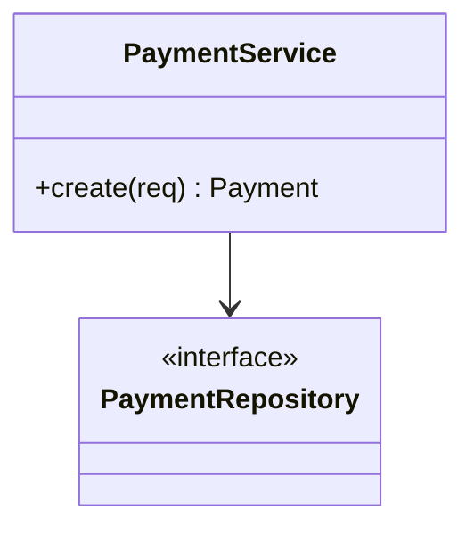
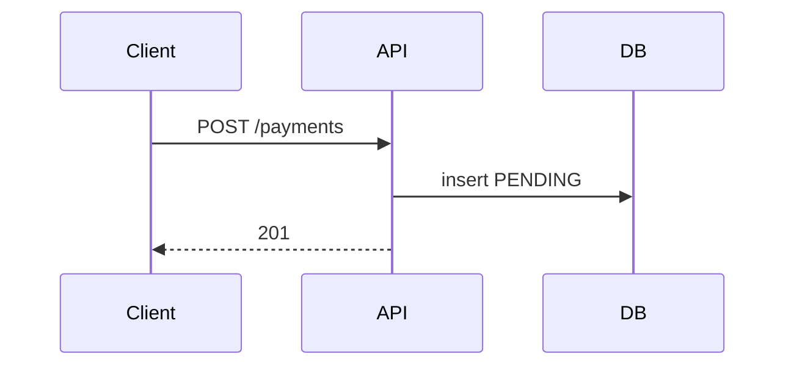

# LLD: <module>

HLD reference: <link>. Requirements: FR-.., NFR-..

## Module Structure
## Class Diagram

## Sequence Diagrams

## Database Schema
```sql
-- additive migration; destructive changes marked NEEDS APPROVAL
```
## API Specification
## Error Handling
| Condition | Exception | HTTP | Code | Retry? |
|---|---|---|---|---|
## Transactions and Concurrency
## Patterns
## Test Approach
## Traceability
