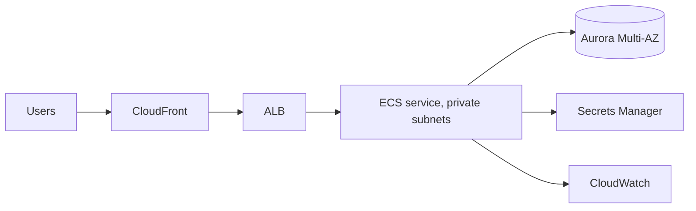

# AWS playbook

## Compute decision
| Option | Choose when | Watch out |
|---|---|---|
| ECS on Fargate | Containers, small team, steady or bursty load | Less control over nodes; cost at sustained high scale |
| EKS | Kubernetes already required, many teams, ecosystem needs | Operational burden, upgrade cadence |
| Lambda | Event-driven, spiky, short tasks | Cold starts, 15-minute limit, connection management to databases |

## Network layout (single region, 2+ AZs)
Public subnets: ALB and NAT only. Private app subnets: tasks/pods. Private data subnets: RDS/Aurora, no internet route. VPC endpoints for S3, ECR, Secrets Manager and CloudWatch to reduce NAT traffic. Security groups reference each other, not CIDR ranges.

## Data and DR
Automated backups with tested restore; Multi-AZ for availability; cross-region backup copy if RPO requires; define RPO/RTO and rehearse. S3 versioning and lifecycle rules; encryption with KMS.

## IAM guardrails
One role per workload, least privilege, no wildcard action/resource without a written reason, no long-lived keys (use roles), permission boundaries for delegated admin, MFA for humans, CloudTrail enabled.

## Observability
CloudWatch metrics and alarms on error rate, latency, saturation and cost anomalies; structured logs with retention; alarms route to an on-call channel; dashboards per service.

## Cost levers (estimates only)
Right-size, Savings Plans or reserved capacity for steady load, Graviton where compatible, S3 lifecycle, NAT and cross-AZ traffic review, log retention limits.

## Well-Architected checklist
Operational excellence, security, reliability, performance efficiency, cost optimisation, sustainability: one explicit answer per pillar in every design.

## Rollback
Blue/green or rolling with health checks and automatic rollback on failed alarms; database changes use expand-and-contract; keep the previous task definition and image tag available.
